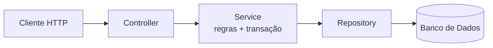

# SGA – Sistema de Gerenciamento Acadêmico (Aula 07)
**Disciplina:** Programação Web II — Camada de Serviço, Regras de Negócio e Transações
**Aluno(s):** _preencha aqui_

## Pré-requisitos e execução
- JDK 21, Maven (wrapper `mvnw` incluído) e **PostgreSQL**.
- Crie o banco: `CREATE DATABASE sistema_academico;`
- Usuário/senha: por padrão `postgres`/`postgres`. Para outros valores, defina as variáveis de ambiente `DB_USER` e `DB_PASSWORD` (não grave senhas no repositório).

```bash
./mvnw spring-boot:run     # sobe a API em http://localhost:8080 (Flyway cria as tabelas)
./mvnw test                # testes unitários (JUnit 5 + Mockito)
```
Swagger: http://localhost:8080/swagger-ui.html

### Endpoints
| Recurso | Endpoints |
|---|---|
| Alunos | `POST/GET /api/alunos`, `GET/PUT/DELETE /api/alunos/{id}` |
| Cursos | `POST/GET /api/cursos`, `GET/PUT/DELETE /api/cursos/{id}` |
| Matrículas | `POST/GET /api/matriculas`, `GET /api/matriculas/{id}` |
| Status | `PATCH /api/matriculas/{id}/trancar`, `/cancelar`, `/concluir` |
| Rollback (Ex. 05) | `PATCH /api/matriculas/{id}/cancelar-com-falha` |

Erros retornam JSON padronizado (`ErroResponseDTO`): 404 recurso inexistente; 400 regra de negócio, validação, JSON/enum inválido e parâmetro inválido; 500 erro inesperado.

---
## Exercício 01 – Separação de responsabilidades

**1. Responsabilidades das camadas**
- **Controller:** recebe a requisição HTTP, converte JSON em objetos, chama o Service e devolve a resposta (status HTTP + corpo). Não decide regras.
- **Service:** concentra as regras de negócio (validações, transições de status) e define as transações.
- **Repository:** acesso a dados; consultas e persistência via Spring Data JPA, sem regra de negócio.

**2. Por que regras de negócio não ficam no Controller?**
O Controller é a porta de entrada HTTP. Se as regras ficarem nele: (a) não podem ser reutilizadas por outras entradas (outro controller, job agendado, mensageria); (b) ficam difíceis de testar sem subir o contexto web; (c) a transação ficaria mal delimitada; (d) o código mistura preocupações e fica difícil de manter.

**3. Quem verifica matrícula ativa duplicada?**
A camada **Service** — é uma regra de negócio. Ela usa o Repository (`existsByAlunoIdAndCursoIdAndStatus`) apenas para consultar o dado.

**4. Fluxo de uma requisição de matrícula**
```
Cliente --POST /matriculas--> Controller --> Service --> Repository --> Banco de Dados
                                  ^             |  (valida aluno, curso e duplicidade; abre transação)
                                  |             v
Cliente <--201 Created/JSON-- Controller <-- Service <-- Repository <-- (INSERT + commit)
```
1. O cliente envia `POST /matriculas` com `alunoId` e `cursoId`.
2. O Controller desserializa o JSON e chama `matriculaService.matricular(...)`.
3. O Service inicia a transação (`@Transactional`), busca aluno e curso via Repository e verifica duplicidade.
4. Se alguma regra falhar, lança `RegraNegocioException` → rollback → o `GlobalExceptionHandler` devolve o erro em JSON.
5. Se tudo estiver certo, o Service cria a `Matricula` (status ATIVA) e chama `save()`.
6. O Repository (JPA/Hibernate) executa o INSERT; no fim do método ocorre o commit.
7. O Controller responde `201 Created` com os dados da matrícula.



## Exercício 02 – Validação de matrícula
Implementado em `MatriculaService.matricular()`: verifica aluno, curso, duplicidade e grava com status `ATIVA`; qualquer violação lança `RegraNegocioException`.

## Exercício 03 – Exceções de negócio
`RegraNegocioException` (estende `RuntimeException`) com métodos de fábrica para: aluno não encontrado, curso não encontrado, matrícula ativa já existente e operação incompatível com o status atual. Tratada globalmente em `GlobalExceptionHandler`.

## Exercício 04 – Estados da matrícula
`trancarMatricula`, `cancelarMatricula` e `concluirMatricula` passam por `transicionar()` → `validarTransicao()`. Só é permitido partir de `ATIVA`; qualquer outra transição lança exceção de negócio.

| Operação | Estado inicial | Estado final |
|---|---|---|
| Trancar | ATIVA | TRANCADA |
| Cancelar | ATIVA | CANCELADA |
| Concluir | ATIVA | CONCLUIDA |

## Exercício 05 – Transações com @Transactional
**1. Objetivo:** garantir que um conjunto de operações no banco seja atômico: ou todas são confirmadas (commit) ou todas são desfeitas (rollback). Isso preserva a consistência dos dados.

**2. Aplicação:** os métodos públicos de `MatriculaService` são anotados com `@Transactional`. `transicionar()` altera a matrícula **e** grava um `HistoricoMatricula` — duas alterações na mesma transação.

**3 e 4. Simulação e verificação:** `cancelarComFalhaSimulada(id)` faz as duas alterações e depois lança `IllegalStateException` (exceção não verificada).
Para verificar:
1. Crie uma matrícula ATIVA (`POST /matriculas`).
2. Chame `PATCH /matriculas/{id}/cancelar-com-falha` → retorna erro 500.
3. Consulte o banco (psql/pgAdmin): `SELECT status FROM tb_matricula WHERE id = {id};` e `SELECT * FROM tb_historico_matricula WHERE matricula_id = {id};`

**Resultado esperado/observado:** a matrícula continua `ATIVA` e não existe registro no histórico — as duas alterações foram revertidas. _(Execute e confirme no seu ambiente; anexe um print se o professor pedir.)_
Obs.: por padrão o Spring só faz rollback para exceções não verificadas (`RuntimeException`/`Error`); para exceções verificadas é preciso `@Transactional(rollbackFor = ...)`.

**5. Commit × rollback**
- **Commit:** confirma a transação; todas as alterações passam a ser permanentes e visíveis para outras transações.
- **Rollback:** desfaz todas as alterações feitas desde o início da transação, deixando o banco como estava antes.

## Exercício 06 – Dirty checking
Em `transicionar()`: a matrícula é consultada por id (`findById`), a transição é validada, e o status é alterado com `matricula.setStatus(...)` dentro da transação — **sem chamar `save()`**.

**Por que funciona?** Dentro de uma transação, a entidade carregada fica *gerenciada* pelo `EntityManager` (contexto de persistência). O Hibernate guarda uma cópia do estado original e, antes do commit (flush), compara com o estado atual. Se houver diferença ("entidade suja"), gera o `UPDATE` automaticamente. Por isso `save()` é desnecessário para entidades já gerenciadas. Fora de uma transação (entidade *detached*), isso não acontece.

## Exercício 07 – Exclusão de aluno e curso
`AlunoService.excluir()` e `CursoService.excluir()`:
1. Verificam existência.
2. Bloqueiam a exclusão se houver matrícula `ATIVA` (mensagem apropriada).
3. Tentam excluir e fazem `flush()`; se o banco rejeitar por integridade referencial (`DataIntegrityViolationException`, ex.: matrículas antigas vinculadas), lançam `RegraNegocioException` com mensagem clara.

## Exercício 08 – Testes
`MatriculaServiceTest` (JUnit 5 + Mockito, repositórios com `@Mock`) cobre: matrícula criada, aluno inexistente, curso inexistente, matrícula duplicada, trancamento válido, conclusão inválida e cancelamento válido.

## Desafio integrador
Fluxo completo: `MatriculaController` → `MatriculaService` → `MatriculaRepository` → Banco, com criação, prevenção de duplicidade, mudanças de status, tratamento global de exceções e transações.

---
## Migration Flyway
A tabela `tb_historico_matricula` (usada no Ex. 05) é criada pela migration V4 em `src/main/resources/db/migration`.

## Dependências necessárias no pom.xml
`spring-boot-starter-web`, `spring-boot-starter-validation`, `spring-boot-starter-data-jpa`, Flyway, PostgreSQL e `spring-boot-starter-test` (já inclui JUnit 5 e Mockito).
